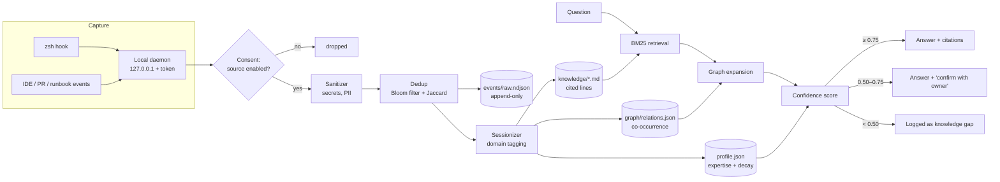

# TwinAI

[](https://github.com/ANIRUDH-VADERA/TwinAI/actions/workflows/ci.yml)


**A passive, privacy-first agent that turns an engineer's everyday work into a queryable "knowledge twin", so teammates get answers even when the expert is offline.**

> I co-built the original TwinAI with a team of four at a company hackathon. My part was the platform architecture, the capture daemon, and the knowledge engine, and the team now uses it day to day. **This repository is an independent open-source reimplementation written from scratch.** It contains none of the original code. It keeps the architecture and ideas and replaces company-internal integrations with generic ones.

## The problem

The person who knows how a system works is often on leave, in another time zone, or has left. Wikis only hold what someone remembered to write down. TwinAI captures knowledge as a side effect of normal work, with the owner's consent, and answers questions from it with citations.

## Architecture



| Component | File | Notes |
|---|---|---|
| Sanitizer | [`sanitize.py`](src/twinai/sanitize.py) | Redacts private keys, cloud and GitHub tokens, JWTs, bearer tokens, `*_PASSWORD=`-style assignments, credentials in URLs, emails, card numbers, Aadhaar and PAN. Runs **before** anything is stored. |
| Deduplication | [`dedup.py`](src/twinai/dedup.py) | A Bloom filter (double hashing over SHA-256) catches exact repeats in constant memory. Shingled Jaccard similarity over a sliding window catches near-repeats. |
| Sessionizer | [`sessions.py`](src/twinai/sessions.py) | Splits activity into work sessions on idle gaps and tags each with domains (Kubernetes, Kafka, Postgres, …). |
| Knowledge base | [`kb.py`](src/twinai/kb.py) | Plain Markdown pages per domain where every line cites its source and timestamp, a co-occurrence graph, and an expertise profile with a 90-day half-life. Can auto-commit to a private Git repo you own. |
| Retrieval | [`bm25.py`](src/twinai/bm25.py) | Okapi BM25 implemented from scratch. |
| Query engine | [`twin.py`](src/twinai/twin.py) | BM25, then a boost for the best domain and its graph neighbours, then citation dedup, then a confidence score. |
| Routing | [`router.py`](src/twinai/router.py) | Sends a question to the teammate whose twin fits best: `0.7 × expertise + 0.3 × availability`. Out-of-office scores highest, because that is when a twin is most needed. |
| Daemon | [`daemon.py`](src/twinai/daemon.py) | Standard-library HTTP server bound to localhost. Every write needs a per-install token, compared in constant time. Body size is capped and captured content is never logged. |
| Terminal hook | [`hooks/twinai.zsh`](hooks/twinai.zsh) | Sends each command and its exit code in the background. Commands typed with a leading space are never captured. |

### Confidence score

```
confidence = (0.4 · source quality + 0.3 · recency + 0.2 · expertise + 0.1 · corroboration) × relevance
```

- **Source quality:** PR reviews and runbooks count for more than chat.
- **Recency:** halves every 120 days.
- **Expertise:** the owner's activity in that domain, relative to their strongest domain.
- **Corroboration:** how many different sources agree.
- **Relevance:** the share of the question's terms the cited passages actually cover, so a one-word match never looks confident.

## Quick start

No dependencies; Python 3.11+ only.

```bash
git clone https://github.com/ANIRUDH-VADERA/TwinAI.git && cd TwinAI
pip install -e .
twinai demo
```

The demo builds two twins (alice and bob) from [sample events](src/twinai/data/sample_events.ndjson), then asks questions and routes one:

```
alice ingest: IngestReport(accepted=9, duplicates=1, blocked_source=1, redactions={'assignment': 1})

Q: how do I check kafka consumer lag for the orders topic?
[answered | confidence 0.75]
From alice's work:
- Consumer lag on the orders topic comes from a slow partition: partition 7 owns the hot merchant key. ...  [ide]
- `kafka-consumer-groups --bootstrap-server localhost:9092 --describe --group orders-ledger-writer`  [terminal]
...
- `export DB_PASSWORD=[REDACTED] && psql -h db -U app`  [terminal]

Q: what is our holiday policy?
[gap | confidence 0.00]

Routing: how do I roll back a bad kubernetes deployment?
  bob    score=0.99 domain=kubernetes expertise=0.99 (ooo)
  alice  score=0.26 domain=kubernetes expertise=0.25 (available)
```

Notice what happened: the browser event was blocked by consent, the repeated command was deduplicated, and the password was redacted before it reached disk.

## Run it for yourself

```bash
twinai init --owner "$USER"          # creates ~/.twinai with a private capture token (chmod 600)
twinai serve &                       # daemon on 127.0.0.1:7331
echo 'source /path/to/TwinAI/hooks/twinai.zsh' >> ~/.zshrc
# ...work normally...
twinai ask "how did I fix the consumer lag last time?"
```

HTTP API (writes need the `x-twinai-token` header):

| Method | Path | Body |
|---|---|---|
| `GET` | `/health` | none |
| `POST` | `/capture` | `{"source": "terminal", "content": "...", "meta": {"exit_code": 0}}` or a list of these |
| `POST` | `/query` | `{"question": "..."}` |

## Privacy by design

- **Opt-in sources.** Only `terminal`, `ide`, `pr_review` and `runbook` are on by default; `browser`, `chat` and `llm_chat` must be enabled explicitly.
- **Sanitized before storage.** Secrets and personal data never reach disk.
- **Local only.** The daemon binds to `127.0.0.1` and requires a per-install token.
- **Auditable.** The owner holds the data as plain files, and every answered question and every gap is logged for them to review.

## Tests

```bash
python -m pytest      # 13 tests: sanitizer, Bloom filter, dedup, sessions, BM25, consent, graph, routing, daemon auth
```

## Roadmap

- An optional LLM step to turn cited passages into prose answers, behind the same confidence gates.
- Team and org roll-ups, so you can ask who knows X and Y across many twins.
- VS Code extension capture.

## License

MIT
